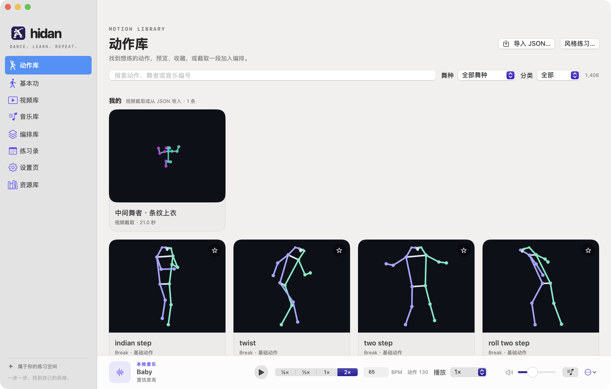
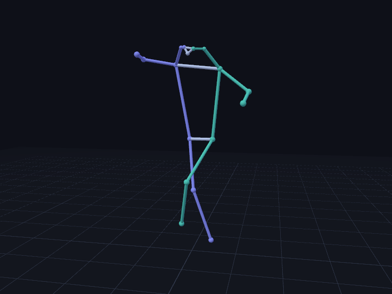
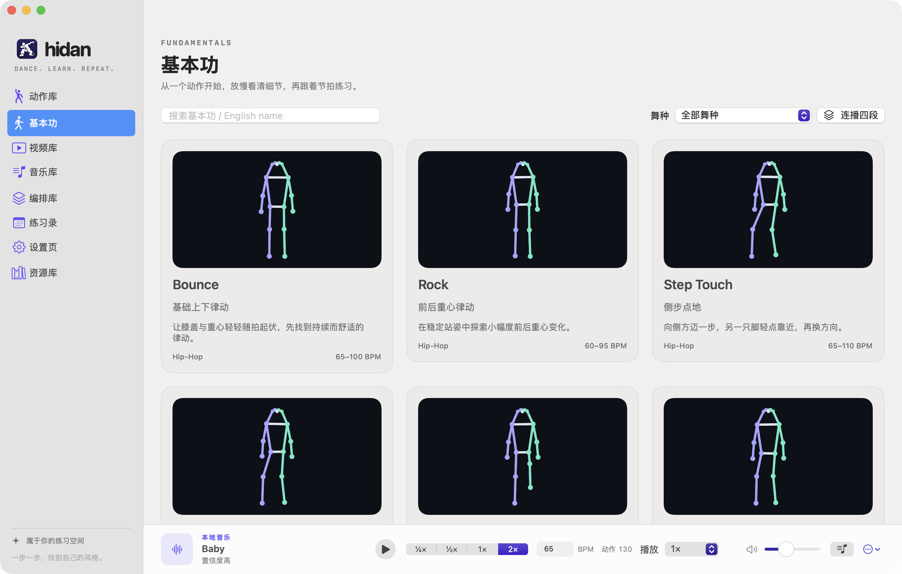
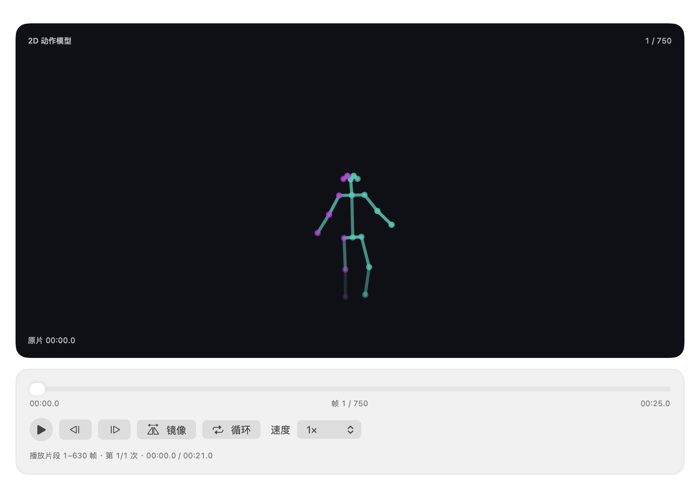
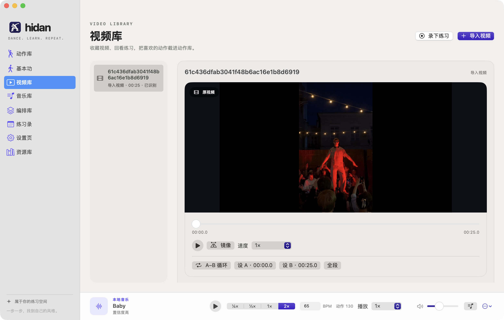
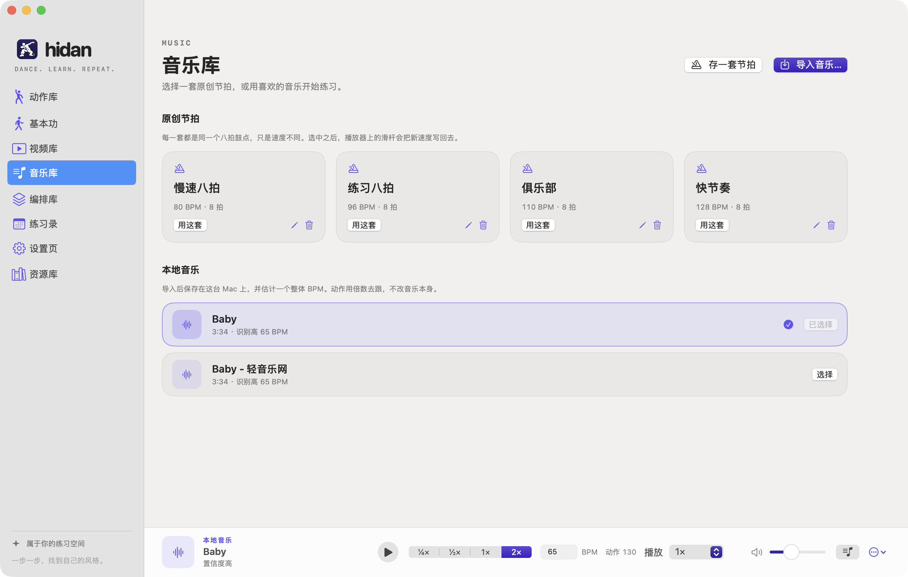
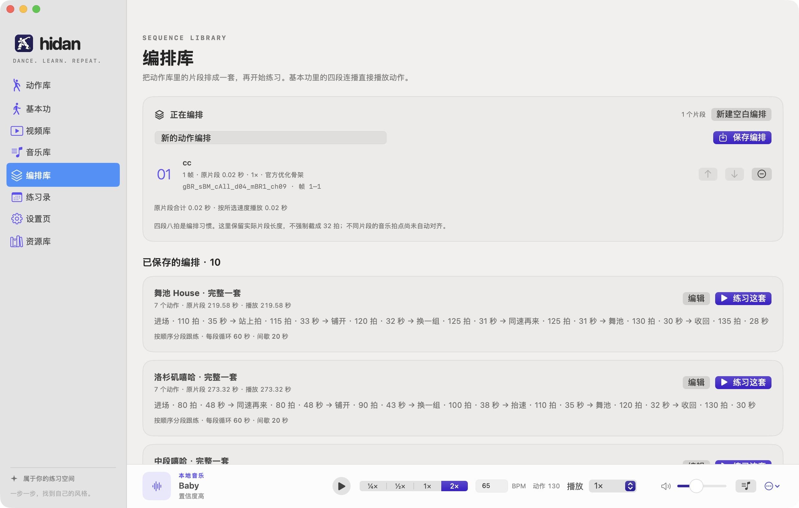
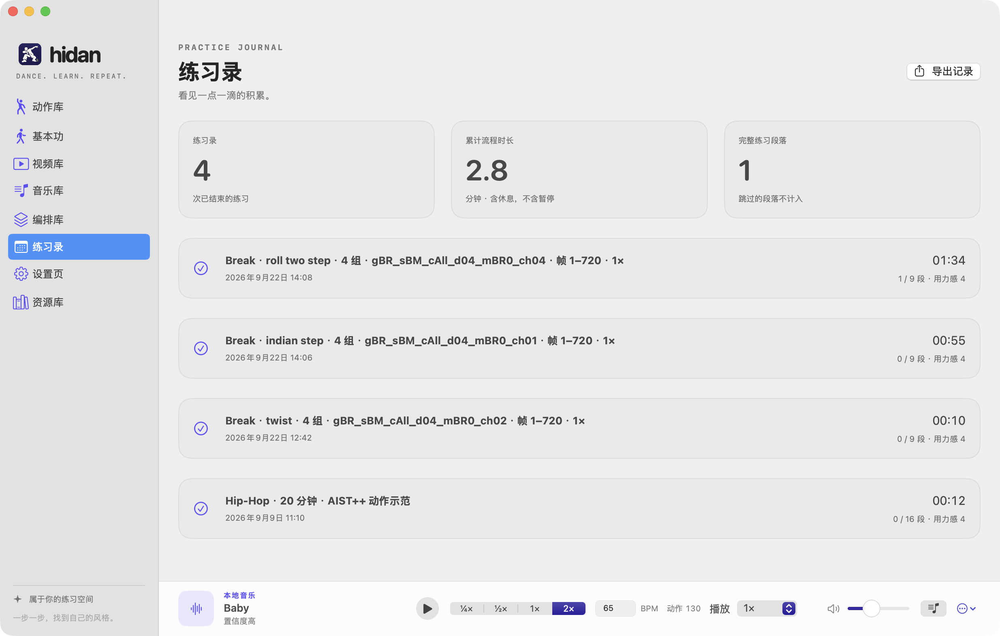
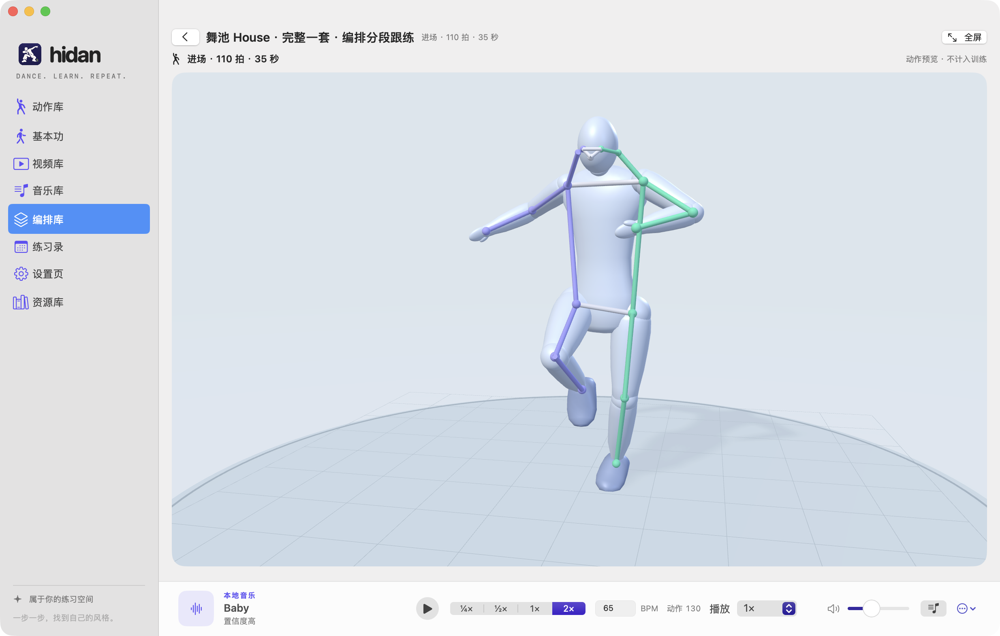

# hidanclub

一起跳舞吧。

这是我在 Mac 上给自己做的街舞练习台。打开就能选一段动作，放慢看清楚，跟着拍子做，录下来回看，下次接着练。GitHub 上那句介绍是「一起跳舞吧，夜店的king」；应用里写得更安静一点：属于你的练习空间。一步一步，找到自己的风格。

当前是 **0.5.0**，只在 **macOS 14** 及以上跑过。iPhone / iPad 还没做。

下面这张是 2026-09-24 在我自己的 Mac 上截的整窗，窗口标题是 Hidan Club。中间那个人形来自本机的 AIST++ 三维动作，不是内置的教学视频。



*动作库。侧栏停在「动作库」，柔光人形正在播 Break 基础片段 `gBR_sBM_cAll_d04_mBR0_ch01`，0.25 倍，A–B 停在 0–1920。右侧是动作目录，底部音乐条是一套 90 BPM 的原创节拍。*

更细的结构、数据模型和练习记录怎么落盘，写在 [项目介绍](docs/项目介绍.md)。原来 README 里的安装说明、数据目录和校验脚本都挪到那里了，没有删。

## 为什么做

我想要的闭环很具体：选一个目标，看示范，拆开慢练，跟拍，回看，记下这次练了多久，下次再来。

课程视频不能因为网上能播就塞进应用。所以现在的示范只有两处：我自己写的 16 张基本功文字卡，以及本机另外安装的 AIST++ 三维标注。身体关节用这台 Mac 上的 Apple Vision 认，不上传。跟练时给的是入镜、关节看得见看不见、肘膝的投影角度。它不打分，也不帮你起舞步名字。

## 现在能做什么

侧栏九项，名字都是三个字：动作库、基本功、视频库、音乐库、编排库、一起跳、练习录、设置页、资源库。点进练习时侧栏会让开，变成一块全屏训练台。底部那条音乐一直在。

### 动作库

找到想练的动作，预览、收藏，或截一段加入编排。

目录来自本机的 AIST++：1,408 条序列、10 个舞种、1,123,873 个独立三维帧，精确 60 FPS。每条都要同时有原始坐标和官方优化坐标，缺一套就不会出现。播放不抽帧，变速只改帧和帧之间的等待。可以搜、收藏、看逐帧、设 A–B、按八拍取一段。列表里的自动播放用原始逐帧重建；点开一条或开始练习时，用设置页选的那一套，默认是官方时序优化。

四种训练风格（Hip-Hop、Popping、Locking、House）各挂了 3 个真实命名动作。选 10 到 45 分钟，可以排出一段带热身、练习、休息、放松的计划，每个练习段对得上一条模型。热身和休息只预告下一段，不把舞蹈示范当成热身指导。

同一页还有「我的动作」：视频里截出来的二维片段，或从 JSON 导入的副本。右上角「导入 JSON…」接受完整导出（`*.hidanclub.json`）或裸识别报告。导入只读原文件，另存一份，原始帧、置信度和原始时间戳都留着。文字卡和这些 AIST 片段还没有逐条对应。

外观有柔光人形、霓虹人形、经典骨架，可以叠骨架、网格和关节名。体型、手掌和鞋形脚是画出来的，不改原始关键点，也不是 SMPL。



*动作播放器里的经典骨架。黑底，左右关节分色，底部是这一段的播放进度。画面上没有写出动作名字。*

### 基本功

16 张原创文字卡，Hip-Hop、Popping、Locking、House 各一组。每张有一段说明、几个要点、常见问题，以及一个 BPM 范围。这是我写的站立练习提示，不是授权视频，也还没经过教练核对。卡片上写了：疼或者晕就停。

点开一张会看到程序生成的站立人形，用来看时序，不是影像捕捉，也不评分。可以单练，也可以「连播四段」。四段连播是按规则排的 4×8 拍动作清单，不是生成出来的身体动作，也不保证两段之间接得上。



*基本功。Hip-Hop 被选中，下面是「基础上下律动」「前后重心律动」「侧步点地」这些文字卡。底部仍是 90 BPM 的原创节拍。*



*点开「基础上下律动」之后。中间是生成的站立人形，1.00 倍；下面是这张卡的要点和常见问题。*

### 视频库

多选导入本地视频，按原字节保存，重启还能播。训练台里手动录像也会进这里。录像是当时相机尺寸的画面，不录音，也不把示范或骨架画进去。

「开始肢体识别」用 Apple Vision 逐帧提取二维关节。无人、多人、低置信度的帧都留着，原始时间戳也留着。之后可以按全身动作变化看分段建议；你点了应用，才去改 A–B、顺序和重复次数，再导入动作库。它不重新生成舞步，也不做过渡动画。原视频的播放、镜像、慢放、A–B 循环还在，用来核对认出来的结果。



*视频库。左侧一条 1920×1080、33.37 秒的 MP4，右侧是它的播放器，按钮写着「开始肢体识别」。*

### 音乐库

两类东西，播放器样式不一样。

原创节拍可以存多套，每一套记住自己的速度。导入的本地音乐按原字节留下，本机估一个整体 BPM，也可以手改。动作按 ¼×、½×、1×、2× 跟着走，音乐本身不改速。估的是整段速度，没有第一拍；短于大约 8 秒，或者听不出稳定周期，就得自己填 BPM。视频里截出来的动作没有这条 BPM，仍按原片时间播。

底部音乐条和动作共用一次点击：从音乐按钮也能开始练习。全新播放时，动作和拍子从同一个下拍起。



*音乐库。上面原创节拍里 90 BPM 那套被选中，下面是已经导入的本地音乐，例如 `01_120_beat_4-4_1.mp3`。*

### 编排库

把动作库里设好 A–B 的三维片段排成一套：排序、命名、保存，再「练习这套」。练习按顺序分段：热身 60 秒，每段循环 60 秒，段间休息 20 秒，最后放松 30 秒。这里保留片段的真实长度，不把它们截成 32 拍。不同片段的拍点还没有自动对齐。

编排库现在只排这些三维片段。二维视频动作留在动作库的「我的动作」里。`CapturedLibraryStore` 里还留着「导入到编排」的代码，这一页没有那个按钮。



*编排库。上面「正在编排」还是空的，提示去动作里设 A–B。下面已保存一套「编排 2026/9/24 23:16」，5 个动作，原片段 19.7 秒。*

### 训练台

从动作、基本功、编排或视频走进来，内容已经带着，训练台不再让你重选来源。也可以不带示范，只开摄像头。

四种画面：并排、只看示范、只看摄像头、叠加。叠加可以拖、可以改大小和透明度，是眼睛对照，没有做相机标定，也没有把人和示范自动对齐。开始、暂停、换段、结束会带着示范一起动。缺了示范就不能开始那段有示范的训练。

摄像头第一次点开才要权限。关节和这一帧画面一起显示，可以镜像。多人入镜时不自动挑一个人。点「开始录像」才录，停了以后进视频库。



*全屏训练台，并排。左边三维示范标题是「基本律动」，阶段停在热身，还剩 00:59。右边是摄像头里的人。音乐条 95 BPM、0.50 倍。*



*全屏训练台，只看摄像头。人在画面里，上面叠着二维骨架。阶段是「基础上下律动 · 第 1/4 组」。音乐条 95 BPM、1.00 倍。*

### 一起跳

> 截图占位：这次没有「一起跳」的窗口图。下面按现在的代码写。

一台 Mac 开房间，用 Bonjour 广播，也可以走点对点 Wi-Fi。另一台从附近列表加入，或手输 `IP:端口`，再输入 4 位房间码，房主确认后配对。链路用房间码派生的 TLS 1.2 预共享密钥。画面用 VideoToolbox H.264 直接发给对方，宽度 640 或 960，和同一帧的关节一起显示。共享可以选不共享、只共享骨架、或画面加骨架，默认不共享。

底部音乐条就是共享节拍。房主的播放、暂停和速度会镜像给客人。「一起开始」用 NTP 式对钟，两边同一瞬间倒数，客人在下一个八拍进来。导入的音乐不传过去，对方听到的是同速的原创节拍。一次只连一位朋友，不经服务器，不保存，不录音。同一网络或 VPN 内网可以；没有 NAT 穿透，没有中继，没有多人房间，没有语音，也不同步三维示范。

### 练习录、设置页、资源库

这三页这次没截。

练习录在训练正常结束时写下这次的计划名、实际跑过的时间、走完的段落，以及 1–10 的用力感。暂停和跳过的时间不算完成。可以导出 JSON。运行中的练习不会在下次启动时接上；崩溃或强制退出也不保证录像收尾。

设置页管人形样式、坐标来源（原始或官方优化）、默认画面、默认组数（2 / 4 / 6），以及进练习时要不要开摄像头。数据目录也能从这里打开。

资源库是一列外链和许可边界：AIST++、FineDance、EDGE、AMASS、Apple Vision、STEEZY、Red Bull Dance。课程和论文都不进安装包。

## 现在明确没有的

这些不是忘了写，是代码里就没做：

- 没有内置教学视频、商业音乐或模型权重。
- 不自动给舞步起名，不打分，不从你的视频恢复三维，不自由生成三维编舞。
- 不对齐第一拍，不跟乐曲中间的变速，不接 MusicKit。
- 基本功文字卡还等教师看过。
- 「一起跳」不到公网 NAT 后面，也不做多人、语音、三维示范同步。
- 视频动作的播放进度不写入普通练习录。
- 已导入的动作副本，界面上还不能删。重复导入会再存一份，并在提示里说明。

## 怎么在这台 Mac 上跑

需要 macOS 14 或更高，以及带 Swift 6 工具链的 Xcode。`Package.swift` 写的是 `swift-tools-version: 6.0`，源码用 Swift 5 语言模式。没有 `.xcodeproj`，也没有 XcodeGen，工程就是这个 Swift 包。

仓库没写死小版本号。脚本会到 `/Applications/Xcode.app` 里找 SwiftUI 宏插件；只装 Command Line Tools、不装完整 Xcode 时，应用通常编不过。

```bash
./script/build_and_run.sh          # 编译、打成 dist/HidanClub.app、签名并打开
./script/build_and_run.sh --build  # 只构建
./script/test.sh                   # 核心探针；本机有 XCTest 时再跑 swift test
```

构建结果是 `dist/HidanClub.app`，包标识 `club.hidan.mac`。Codex 环境里的 Run 按钮也是同一条脚本。

用 Xcode 打开时，打开仓库根目录的 `Package.swift` 就行，让 Xcode 自己生成工程，不要另存一份进 Git。

签名是本机 ad-hoc：`codesign --force --deep --sign -`。不需要付费开发者账号，也不走「用免费 Apple ID 签到 iPhone」那套，因为这不是 iOS 应用，没有 iOS target。第一次开摄像头、第一次搜索或开「一起跳」房间时，macOS 仍会问相机和本地网络权限。文案已经写在构建脚本生成的 `Info.plist` 里。这不是 App Store 包，也没有沙盒公证。

动作库要有数据才不是空的。AIST++ 不进 Git，也不进 `.app`。新机器上：

```bash
python3 script/aist_dataset.py
python3 script/aist_dataset.py --verify-only
```

这一步要 Python 3.10+、NumPy 2.x 和 curl。应用自己运行不依赖 Python、第三方包、云端密钥或下载模型。装好后数据在 `~/Library/Application Support/HidanClub/Datasets/AISTPlusPlus/`。合同和校验见 [AIST++ 接入说明](docs/AIST_DATASET.md)。

其余脚本、环境变量和各目录的含义见 [项目介绍](docs/项目介绍.md#怎么构建怎么校验)。

## 技术栈

| | |
| --- | --- |
| 界面 | SwiftUI，macOS 14+。窗口默认 1280×850，最小 1100×740 |
| 语言 | Swift 6 工具链，Swift 5 语言模式 |
| 工程 | Swift Package Manager。可执行目标 `HidanClub`，纯 Foundation 库 `HidanCore` |
| 媒体与视觉 | AVFoundation、Vision、VideoToolbox、系统相机 |
| 一起跳 | Bonjour、Network、TLS 1.2 PSK、本机 H.264 |
| 数据 | 本机 Application Support 里的 JSON 和原文件副本。没有服务器账号 |
| 测试 | `Tests/HidanCoreTests` 的 XCTest，加上 `script/` 里不依赖 XCTest 的探针 |

## 推断的下一步

下面是从代码、现有文档和还没收口的入口看出来的，不是排期。

- iPhone / iPad。产品说明里写过 Mac 优先、以后再扩展，现在没有任何 iOS target。
- 第一拍、乐曲中途变速、两段视频对齐着回看。节拍估计自己也写了：只给一个整体 BPM。
- 舞步名字、质量评分、从用户视频估计三维、自由生成编舞。方案文档把它们放在后面，而且都要求教师标签或单独许可，不是再调一个参数就能开。
- 基本功文字卡和 AIST 片段逐条对应，以及请人核对动作名、文化语境和常见错误。
- 崩溃或强制退出之后把没写完的练习接回来；已导入副本的删除；视频跟练进度写进练习录。
- 「一起跳」的 NAT 穿透、中继、多人和语音。协议和界面都按「同一网络、一次一位」写的。
- 原 AIST 视频和音乐。标注是 CC BY 4.0，片子和曲子是另一套条款，下载脚本故意不取。

## 许可和致谢

仓库根目录没有 `LICENSE`。应用里的基本功文字和节拍是原创的，随包的说明在 `Sources/HidanClub/Resources/NOTICE.md`。标志的做法和提示词在 [Logo 说明](docs/BRAND.md)。

AIST++ 三维标注 © Google LLC，[CC BY 4.0](https://creativecommons.org/licenses/by/4.0/)。论文是 Ruilong Li、Shan Yang、David A. Ross、Angjoo Kanazawa，*AI Choreographer*，ICCV 2021。表演来自 AIST Dance Video Database（Tsuchida 等，ISMIR 2019）。100 个基础动作原名来自 AIST 的 `choreo.xlsx`，保留原文，不是本应用认出来的，也不要标成 Google 标注的产物。这些数据不在 Git 里。

原视频、原音乐、SMPL 人体和上面资源库里的课程都没有打进包。

## 文档

- [项目介绍](docs/项目介绍.md)：目录、模块、练习数据、本机文件、全部校验脚本
- [产品与技术方案](docs/PRODUCT_AND_TECHNICAL_PLAN.md)
- [实时训练台](docs/TRAINING_STUDIO.md)
- [AIST++ 下载与数据合同](docs/AIST_DATASET.md)
- [3D 人形与骨架](docs/AIST_APPEARANCE.md)
- [验证记录](docs/VERIFICATION.md)
- [动作资源与授权调研](docs/research/dance-resources.md)
- [Apple / 音乐技术调研](docs/research/apple-motion.md)
- [Logo](docs/BRAND.md)
